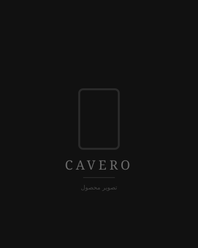

# CAVERO — فروشگاه اینترنتی کت‌وشلوار مردانه



**«استایل رسمی، برای نسل جدید»**

فروشگاه اینترنتی کامل، فارسی و RTL برای کت‌وشلوار مردانه با ظاهر Minimal Luxury.

## Stack

| بخش | تکنولوژی |
|------|-----------|
| Frontend | React 18 + TypeScript + Vite + Tailwind CSS + React Router |
| Backend | Node.js + TypeScript + Express |
| Database | MySQL 8 / MariaDB (درایور `mysql2`، استخر اتصال + تراکنش) |
| Auth | JWT + وریفیکیشن شماره موبایل (OTP) |
| فونت | Vazirmatn (محلی، بدون نیاز به اینترنت) |

## ساختار پروژه

```
sadra/
├── server/          → Backend API (Express)
│   ├── src/
│   │   ├── db/      → schema, migrations, seed, placeholder images
│   │   ├── routes/  → auth, products, articles, cart, orders, users
│   │   ├── middlewares → auth (JWT), error handling
│   │   └── utils/   → OTP, size suggestion algorithm, validators
│   └── .env.example
├── client/          → Frontend (React + Vite + Tailwind)
│   └── src/
│       ├── pages/   → 15 صفحات
│       ├── components/ → Header, Footer, UI, cards
│       ├── context/ → Auth, Cart
│       └── lib/     → API client, types, constants
├── package.json     → npm workspaces + scripts
└── README.md
```

## پیش‌نیاز

- **Node.js ≥ 22** (پروژه با نسخه ۲۶ تست شده)
- **MySQL 8** یا **MariaDB 10.6+** در حال اجرا روی سیستم شما (یا سرور دیگر)

### راه‌اندازی سریع MySQL

ساده‌ترین راه روی ویندوز:

```bash
# نصب MySQL Server (درخواست دسترسی ادمین)
winget install Oracle.MySQL

# یا اگر Docker دارید:
docker compose up -d mysql
```

نام دیتابیس در اولین اجرا **خودکار ساخته می‌شود** (`CREATE DATABASE IF NOT EXISTS`).
فقط کافیست مشخصات اتصال را در `server/.env` تنظیم کنید:

```env
MYSQL_HOST=127.0.0.1
MYSQL_PORT=3306
MYSQL_USER=root
MYSQL_PASSWORD=رمز-شما
MYSQL_DATABASE=sadra
```

## شروع سریع

```bash
# ۱) نصب همه dependencyها
npm install

# ۲) اجرای Migration و Seed (پیش‌فرض ۱۰ محصول + ۱۰ مقاله)
#    دیتابیس MySQL به‌صورت خودکار ساخته و جدول‌ها ایجاد می‌شوند
npm run seed

# ۳) اجرای هم‌زمان Backend + Frontend
npm run dev
```

- Frontend: http://localhost:5173
- Backend API: http://localhost:4000
- Health check: http://localhost:4000/api/health

## دستورات جداگانه

```bash
npm run dev:server   # فقط Backend
npm run dev:client   # فقط Frontend
npm run migrate      # ساخت/به‌روزرسانی Schema
npm run seed         # Seed مجدد (دیتابیس فعلی را پر می‌کند)
npm run build        # Build تولید هر دو بخش
```

## دیتابیس

دیتابیس **MySQL** با نام `MYSQL_DATABASE` (پیش‌فرض `sadra`) در اولین اجرا به‌صورت خودکار
ساخته می‌شود. تمام جدول‌ها با `utf8mb4` (پشتیبانی کامل فارسی) و موتور `InnoDB` ساخته می‌شوند.
اتصال از طریق استخر (Connection Pool) و عملیات چندمرحله‌ای (مثل ثبت سفارش) داخل تراکنش انجام می‌شود.

### موجودیت‌ها

`users`, `otp_codes`, `user_measurements`, `fabrics`, `fits`, `products`,
`product_images`, `sizes`, `product_sizes`, `articles`, `carts`, `cart_items`,
`addresses`, `orders`, `order_items`

### رابطه محصول ← پارچه ← مقاله

- هر محصول یک `fabric_id` دارد.
- هر مقاله می‌تواند `fabric_id` داشته باشد.
- در صفحه محصول، روی نام پارچه (مثلاً «ویسکوز») کلیک کنید → مقاله مربوط به آن پارچه باز می‌شود.
- در صفحه مقاله، محصولات ساخته‌شده از همان پارچه نمایش داده می‌شوند.

## احراز هویت (OTP)

ورود/ثبت‌نام فقط با شماره موبایل و کد تأیید انجام می‌شود.

### حالت ورود (متغیر `AUTH_MODE` در `server/.env`)

| حالت | رفتار |
|------|-------|
| `otp` (پیش‌فرض) | ورود با شماره موبایل + کد تأیید |
| `phone` | ورود فقط با شماره موبایل، **بدون کد** (برای توسعه/تست) |

> برای فعال کردن ورود بدون کد: `AUTH_MODE=phone` را در `server/.env` قرار دهید و سرور را ری‌استارت کنید.

### حالت OTP (متغیر `OTP_MODE` در `server/.env`)

| حالت | رفتار |
|------|-------|
| `console` (پیش‌فرض) | کد تصادفی در **کنسول سرور** چاپ می‌شود |
| `fixed` | کد ثابت `123456` (برای تست خودکار) |
| `sms` | آماده اتصال به سرویس SMS واقعی |

> **توسعه:** برای تست راحت، `OTP_MODE=fixed` را در `server/.env` قرار دهید و همیشه از کد `123456` استفاده کنید.

### کاربران پیش‌فرض (سبد شده)

| نقش | شماره موبایل |
|-----|-----|
| مدیر | `09120000000` |
| کاربر نمونه | `09123456789` |

## پنل مدیریت

پنل مدیریت در مسیر **`/admin`** و فقط برای کاربرانی با `role = admin` قابل دسترسی است.

### ورود به پنل

ورود از طریق صفحه **`/admin/login`** با **نام کاربری و رمز عبور** انجام می‌شود:

| نام کاربری | رمز عبور |
|------------|----------|
| `admin` | `admin123` |

> این مقادیر از `ADMIN_USERNAME` و `ADMIN_PASSWORD` در `server/.env` خوانده می‌شوند.
> برای تغییر رمز، متغیرها را عوض کنید و `npm run admin:set` بزنید (بدون پاک شدن داده‌ها).

### بخش‌های پنل

| بخش | امکانات |
|-----|---------|
| داشبورد | تعداد محصولات/مقالات/سفارش‌ها/کاربران، مجموع فروش، وضعیت سفارش‌ها، آخرین سفارش‌ها |
| محصولات | افزودن/ویرایش/حذف، تصاویر (اصلی + گالری)، موجودی هر سایز، ویژه/فعال، SEO |
| مقالات | افزودن/ویرایش/حذف، دسته‌بندی، پارچه مرتبط، وضعیت انتشار، SEO |
| سفارش‌ها | لیست با فیلتر وضعیت، جزئیات کامل، تغییر وضعیت (Timeline ۵ مرحله‌ای) |
| کاربران | لیست کاربران، تعداد سفارش و مجموع خرید |

API آن زیر `/api/admin` و با میدل‌ور `authRequired + adminOnly` محافظت می‌شود
(`server/src/routes/admin.routes.ts`).

> برای ورود به پنل با کاربر مدیر (`09120000000`) وارد شوید؛ در هدر لینک «پنل مدیریت» ظاهر می‌شود.

## پیشنهاد سایز (الگوریتم)

در حساب کاربری → «اندازه‌ها و پیشنهاد سایز»:

1. اگر **دور سینه** وارد شده باشد ← تعیین سایز مستقیم از جدول.
2. اگر فقط **دور کمر** موجود باشد ← تخمین بر اساس آن.
3. اگر فقط **قد و وزن** موجود باشد ← تخمین.
4. سایز پیشنهادی در `user_measurements.suggested_size` ذخیره و در پروفایل نمایش داده می‌شود.

فایل الگوریتم: `server/src/utils/sizeService.ts`

## قابلیت‌های نسخه اول

- [x] صفحه اصلی (Hero + محبوب‌ترین‌ها + پارچه + مقالات + درباره ما)
- [x] فروشگاه با فیلتر (جنس، مدل، جستجو، مرتب‌سازی)
- [x] صفحه جزئیات محصول با گالری چندتصویری و سایزبندی
- [x] ارتباط پارچه ← مقاله (در دیتابیس، نه hardcode)
- [x] پیشنهاد سایز بر اساس اندازه بدن
- [x] ثبت‌نام/ورود با شماره موبایل (OTP)
- [x] حساب کاربری (پروفایل، اندازه‌ها، آدرس‌ها، سفارش‌ها)
- [x] سبد خرید کامل (افزودن، حذف، تغییر تعداد، اعتبارسنجی موجودی)
- [x] ثبت سفارش + پیگیری وضعیت (Timeline ۵ مرحله‌ای)
- [x] مقالات (۱۰ مورد) با SEO و Metadata
- [x] درباره ما، راهنمای سایز، صفحه ۴۰۴
- [x] طراحی کاملاً Responsive و RTL
- [x] پنل مدیریت (داشبورد، محصولات، مقالات، سفارش‌ها، کاربران)

## تصاویر محصول

در نسخه اول از تصاویر **Placeholder (SVG)** استفاده شده که در مسیر
`server/public/images/` در زمان Seed ساخته می‌شوند.
برای جایگزینی با عکس واقعی: فایل‌ها را در
`server/public/images/products/<slug>/` قرار دهید و نام‌ها را حفظ کنید
(`front.svg`, `back.svg`, `fabric.svg`, `stitching.svg`, `design.svg`).

## امنیت (نسخه اول)

- رمزنگاری حساسات با `bcryptjs`
- JWT با انقضا
- کوئری‌ها همگی parameterized (محافظت در برابر SQL Injection)
- Validations ورودی با Zod در سمت سرور
- CORS محدود به `CLIENT_ORIGIN`
- Secretها از `.env` خوانده می‌شوند (در Git ذخیره نمی‌شوند)
- React به‌صورت پیش‌فرض از XSS جلوگیری می‌کند
- عدم ذخیره اطلاعات حساس بدون هش

## چه چیزهایی در نسخه‌های بعدی

- [ ] درگاه پرداخت آنلاین ایرانی
- [ ] ارسال SMS واقعی
- [ ] کد تخفیف
- [ ] علاقه‌مندی‌ها
- [ ] نظرات کاربران
- [ ] چند آدرس پیش‌فرض و مدیریت کامل‌تر
- [ ] گزارش‌های فروش
- [ ] تاریخچه‌ی دقیق وضعیت سفارش (با timestamp هر مرحله)# cholfish

# cholfish

# cholfish

# cholfish

# cholfish

